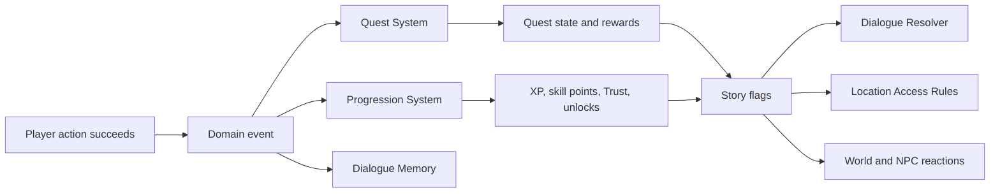
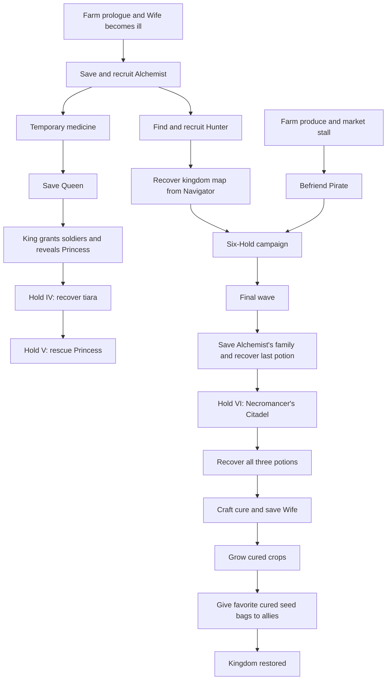

# The Last Cure — Systems Implementation Workflow

Status: planning baseline based on the quest document dated August 25, 2026, the dialogue document dated September 11, 2026, and the repository state inspected September 13, 2026.

## 1. Product goal

Build the story and progression as one connected loop:

1. The player begins at home with their Wife and learns farming through corn and tomatoes.
2. Ordinary work, rumors, and the Wife's illness lead into the Alchemist quest.
3. Farming, fishing, mining, crafting, combat, gifts, and upgrades generate different kinds of progression.
4. Quests and Trust recruit allies and turn the player's farm into a growing community.
5. XP, story requirements, keys, and transportation open increasingly dangerous locations.
6. The Pirate and Hunter make survivor rescue and relocation believable.
7. The six Holds culminate in the Necromancer's Citadel and recovery of all three potions.
8. The Alchemist turns the cure into seeds; farming and remembered favorite plants distribute the cure.

The central design rule is that gameplay systems report what happened. Quest, dialogue, and progression systems react to those reports. Harvesting, crafting, defeating an enemy, or giving a gift should never need story-specific code embedded inside the crop, crafting, combat, or inventory implementation.
AL
## 2. Current foundation and gaps

| Area | Existing foundation | Work needed |
|---|---|---|
| Dialogue | `MerchantDialogue` opens a shop for nearby available merchants. | Add a general NPC interaction resolver, story/quest dialogue runner, choices, memory, and a separate shop action. |
| NPCs | Wandering and scheduled NPCs, merchants, a guard, roles, pathfinding, and daily activity exist. | Give story NPCs stable IDs and authored locations; let all eligible NPCs be talk targets; add relationship state. |
| Quests | No quest runtime or journal exists. | Add data-defined quests, objectives, prerequisites, rewards, event tracking, UI, and saved state. |
| Farming | Tilling, watering, growth, harvesting, crop inventory, and all crop art are present. Corn and tomato already receive five starter seeds. | Add farming points, crop unlock requirements, unlock notifications, and an authored starting farm planted with corn and tomato. |
| Fishing | Pond, river, and ocean pools already exist by season; catches have one to three reel stages. | Add fishing points and filter each pool by unlocked locality and species. |
| Crafting | Recipes, resource allocation, tool restoration, and crafted counts exist. | Add refined resources, recipe unlocks, crafting XP, durable equipment tiers, and Jim's upgrade service. |
| Equipment | Starter tools/weapons and durability values live on `Player`; broken tools are retained. | Consolidate equipment state, add upgrade tier/max durability, apply weapon wear, and persist upgrades. |
| Combat | Melee attacks, guard hostility, health/death, effects, and a simple revive action exist. | Add dedicated enemies, death rewards emitted once, ranged attacks, wave encounters, enemy tiering, and home recovery. |
| World | Deterministic procedural islands, exterior scene templates, houses, farm plots, docks, and streamed chunks exist. | Add authored location instances/interiors, transitions, access rules, story locations, and a designated player-owned farmstead. |
| Saving | Versioned atomic JSON saves include player, chunks, NPCs, and weather. | Add a v1-to-v2 migration and save quests, dialogue memory, Trust, XP, skills, equipment tiers, stamina, location, and story NPCs. |
| Time | A 24-hour game clock, days, seasons, and weather exist. | Add sleeping, awake duration, stamina drain, eating recovery, two-day hard limit, and pass-out recovery. |
| Resources | Breakable rocks and three loose rock drops already exist. | Register the moved beach rocks, land rocks, pebble drop visual, ore spawns, processed iron, and explicit loot definitions. |
| Vessels | New boat frame folders and large ship sheets exist. | Add manifests, animation/controller entities, water collision, mounting, travel, and Pirate transport sequences. |

### Asset observations that affect implementation

- Land rocks are `rocks/1.png` through `rocks/6.png`, all 32×32. They should all have the same loot table: three `rock` items.
- `rocks/pebbles.png` is 32×32 and should be the loose pickup visual for each of the three drops.
- Beach rocks now live under `rocks/beach_rocks/big` and `rocks/beach_rocks/small`. Existing code still requests `rocks/big` and `rocks/small`, so resource loading currently needs updating.
- Ore art contains coal, iron, gold, diamond, ruby, and `blueSaphire`. Internal IDs should use correctly spelled, stable snake-case names such as `blue_sapphire_ore`; filenames can remain unchanged behind the asset manifest.
- Boat animations are 14 separate 288×256 frames for idle and sailing in down, up, and sideways orientations. Load them with numeric ordering so frame 10 does not play after frame 1. Left uses the sideways frames; right uses a horizontal flip.
- Ship sheets use 608×640 cells: 15 idle frames and 17 sailing frames. Sailing wind-effect sheets also contain 17 frames and should advance in sync with the base sailing animation. Sideways left/right can use synchronized horizontal flipping.
- The directional cultist, goblin berserker, goblin slinger, skeleton grunt, and skeleton hunter sheets use 48-pixel cells. Skeleton King files use mixed source dimensions: attack art uses 64-pixel cells while several idle/walk/hurt/death files have 48-pixel-high rows. The animation manifest therefore needs a frame size per animation instead of one frame size for the entire enemy.
- The requested `skeleton_slinger` name does not match the current folder names. The repository contains `goblin_slinger` and the bow-using `skeleton_hunter`. Use explicit enemy IDs in a manifest so this name can be settled without renaming logic throughout the game.
- `floor.png`, `wall.png`, and `furniture.png` are each 320×320. `LoadAssets.character_furniture` currently describes source rectangles in `furniture.png`; it does not describe where furniture is placed in a room. Rename that mapping to `character_furniture_regions` when the interior work begins, then introduce a separate house layout definition containing placements and collision rectangles.

## 3. State ownership

Keep mutable story state in one persisted `GameState`, rather than continuing to add unrelated fields directly to `Player`.

| Owner | Responsibilities |
|---|---|
| `Player` | Movement, health, current equipment, inventory, input locks, and current physical position. |
| `GameState` | Story flags, quests, dialogue memory, Trust, global XP/level, farming/fishing points, unlocks, stamina/awake time, current location, and home identity. |
| `World` / chunks | Terrain changes, plants, removed resources, placed props, doors, and spawned world object state. |
| Content definitions | Immutable quest, dialogue, item, crop, fish, enemy, location, and upgrade definitions. |
| Gameplay systems | Validate actions, mutate their owned state, and publish domain events after an action succeeds. |

Suggested modules:

```text
code/
  data/
    dialogue/
    enemies/
    items/
    locations/
    quests/
    progression/
  gameplay/
    events.py
    game_state.py
    progression.py
    quests.py
    dialogue.py
    interactions.py
    locations.py
    recovery.py
  entities/
    enemy.py
    vessel.py
  ui/
    dialogue.py
    quest_journal.py
```

The existing `ui/dialogue.py` should remain responsible for drawing and input. Story selection, conditions, state changes, and quest actions belong in `gameplay/dialogue.py`. The shop becomes an action launched from a dialogue node, allowing a merchant to speak before opening stock.

## 4. Shared event flow



Use small typed events such as:

- `CropHarvested(crop_id, count, location_id)`
- `FishCaught(fish_id, locality, required_reels)`
- `EnemyDefeated(enemy_id, tier, encounter_id)`
- `ItemCrafted(item_id, recipe_id, count)`
- `EquipmentUpgraded(equipment_id, old_tier, new_tier)`
- `GiftGiven(npc_id, item_id, preference)`
- `DialogueCompleted(npc_id, node_id)`
- `LocationEntered(location_id)`
- `ResourceDestroyed(resource_id, resource_type)`
- `NpcRescued(npc_id, encounter_id)`
- `PlayerSlept(day)` and `PlayerCollapsed(reason)`

Publish events only after the underlying action succeeds. Mark enemy deaths and objective contributions with stable IDs so reloads, repeated animation frames, and duplicate callbacks cannot award XP twice.

## 5. Separate progression tracks

| Track | Earned from | Unlocks | Must not unlock directly |
|---|---|---|---|
| Global XP / level | Enemy defeats, successful crafting, and equipment upgrades. Main quests may award enough XP to keep the story moving. | Dangerous regions and level-qualified locations. | NPC relationships, crops, or fish species. |
| Farming points | Harvesting crops. Corn gives 2; tomato gives 3. | More seed recipes, crop stock, and the ability to plant specific crops. | Castle access or combat locations. |
| Fishing points | Successfully catching fish. Harder fish award more. | Additional pond species, then river access/pools, then sea access/pools. | Story Trust. |
| Character Trust | Gifts, personal quests, rescues, and meaningful dialogue outcomes for one NPC. | Personal dialogue tiers, services, recurring requests, recruitment, and favorite-plant reveals. | Unrelated NPC states. |
| Kingdom reputation | Completing public quests, defending settlements, saving survivors, and royal story actions. | Guard recognition, castle access, soldiers, and public ambient reactions. | Personal recruitment by itself. |

Per-character Trust and kingdom reputation solve an important narrative problem: repeatedly gifting one villager should not make castle guards trust the player. Public accomplishments raise reputation; gifts build a specific relationship.

Recommended initial relationship tiers are `unknown`, `guarded`, `familiar`, `trusted`, and `ally`. Keep exact numbers out of ordinary dialogue UI at first; show the changing tone and a tier change notification. Start balancing around 10–15 ordinary gifts for a relationship built mostly through gifting, with larger gains from that character's quests and favorite gifts. Add a one-gift-per-NPC-per-day full reward or diminishing returns so a player cannot finish an emotional arc by emptying one inventory in a minute.

## 6. Quest system

### Runtime states

Each quest moves through:

```text
LOCKED -> AVAILABLE -> ACTIVE -> READY_TO_TURN_IN -> COMPLETED
                              \-> FAILED (repeatable/defense quests only)
```

Main-story quests should not permanently fail. A lost defense encounter can reset, offer a recovery objective, or retry on a later day. Failure is useful only when the game has an authored way forward.

### Quest definition

Definitions should be data-driven and validated at startup. A definition needs:

- stable ID, title, summary, tier, and story act;
- prerequisites and visibility conditions;
- giver and turn-in NPC IDs;
- one or more typed objectives;
- rewards;
- start/completion actions such as setting a flag, moving an NPC, or unlocking a location;
- repeatability and retry rules;
- journal text for locked hints, active objectives, and completion.

Example shape:

```json
{
  "id": "prologue.morning_chores",
  "tier": "primary",
  "giver": "wife",
  "prerequisites": [],
  "objectives": [
    {
      "id": "water_first_row",
      "event": "crop_watered",
      "filters": {"location_id": "player_farm"},
      "count": 3
    },
    {
      "id": "harvest_breakfast",
      "event": "crop_harvested",
      "filters": {"crop_id": ["corn", "tomato"]},
      "count": 2
    }
  ],
  "rewards": {"kingdom_reputation": 0},
  "on_complete": [{"set_flag": "prologue.chores_complete"}]
}
```

Objective types needed for the complete story include talk, visit, possess/deliver item, give gift, harvest, catch, craft, upgrade, defeat enemy, survive wave, defend target, destroy tagged resources, recover clue/key, rescue NPC, escort/follow, recruit NPC, build/open market, grow cured crop, and distribute seed bag.

Inventory objectives need two modes. `possess` checks current inventory and does not consume anything. `deliver` removes the required items atomically during turn-in. The journal must distinguish them.

### Quest journal

The first journal version needs:

- active quests grouped by story, side, and repeatable;
- objective progress such as `Corn or tomato harvested: 1/2`;
- a completed tab;
- one tracked quest displayed in the HUD;
- a clear reason when a quest is available but blocked by Trust, level, item, or location access.

### Story dependency map



The quest document starts with four Tertiary milestones and later calls `Befriend the Pirate` a Tertiary quest. Recommended resolution: retain the four central Tertiary quests and make `Befriend the Pirate` a required Secondary arc under preparation for `Destroy the Six Holds`. Its result is a service needed by that campaign rather than a separate end-state milestone. If a fifth major milestone is desired in the journal, only the data field needs to change.

## 7. Dialogue system

### Interaction flow

1. `InteractionSystem` finds the best nearby target: NPC, door, bed, chest, shop counter, vessel, or quest object.
2. For an NPC, `DialogueResolver` builds a context from quest states, flags, Trust tier, relationship memory, inventory, location, time, and world state.
3. It selects the highest-priority eligible node that has not been consumed, or a rotating ambient node when no new story node is eligible.
4. `DialogueUI` renders speaker, portrait, paged lines, choices, and continue/close controls.
5. A completed node applies declared actions through system APIs: start/turn in a quest, set a memory flag, give an item, reveal a preference, recruit an NPC, or open a shop.
6. Completion publishes `DialogueCompleted`, allowing quests and world reactions to advance.

Story NPCs need stable IDs such as `wife`, `lillian`, `jim`, `alchemist`, `hunter`, `navigator`, `king`, `queen`, `princess`, `pirate`, and `necromancer`. Their save keys must not depend on their position in `npc_manager.npcs`, because dynamic merchants and rescued survivors will change that order.

### Dialogue definition

```json
{
  "id": "wife.prologue.morning_chores",
  "npc_id": "wife",
  "category": "quest",
  "priority": 100,
  "once": true,
  "conditions": [
    {"flag_is": ["prologue.chores_complete", false]},
    {"quest_is": ["prologue.morning_chores", "available"]}
  ],
  "lines": [
    {"speaker": "wife", "text": "You missed that row again."},
    {"speaker": "player", "text": "I was leaving it for you."},
    {"speaker": "wife", "text": "Of course you were."}
  ],
  "actions": [{"start_quest": "prologue.morning_chores"}]
}
```

### Dialogue priority

Resolve eligible dialogue in this order:

1. mandatory immediate story reaction;
2. quest turn-in;
3. quest offer;
4. one-time major story reaction;
5. Trust-tier or relationship conversation;
6. contextual world dialogue;
7. rotating ambient dialogue;
8. service choice such as shop, upgrade, gift, or leave.

This keeps an urgent Queen conversation from being hidden behind a merchant greeting while preserving shops after story business is complete.

### Choice scope

Use choices for tone, information order, gifts, and service selection. The Navigator confrontation is a good first choice test: accuse, question, or threaten can reveal information in a different order and set a remembered tone flag. The central plot should reconverge so one dialogue choice cannot silently make the story impossible to finish.

### Favorite plants

Favorite plants are NPC memory facts, revealed by one-time relationship nodes at a suitable Trust tier. On reveal:

- store `relationships.<npc_id>.favorite_plant_known = true`;
- add the plant to a codex/relationship note;
- do not label it as an endgame requirement;
- let the finale query the known preference when preparing a cured seed bag;
- provide a late-game reminder path through prior dialogue notes or an Alchemist prompt so forgotten optional dialogue does not hard-lock the ending.

## 8. Player home and starting farm

Treat the player's home as the first authored location and the test bed for all later interiors.

### Home model

- `player.house = "farmhouse"` selects an exterior/home layout ID.
- `LocationManager` owns the current location and transition return point.
- The exterior door targets `player_house_interior`; the interior door returns to the exact exterior door anchor.
- The interior layout composes floor and wall layers, furniture placements, collision rectangles, interaction targets, NPC anchors, and entry/spawn anchors.
- The bed is an interactable object with `sleep` and later `recovery_spawn` anchors.
- The Wife receives a stable NPC anchor and can change activity/position by time and story state.

Do not implement interiors by swapping the entire procedural world. A lightweight authored `LocationInstance` can use the same draw/update/collision interfaces while suspending chunk streaming until the player exits. The same system can later host the castle, inn, Alchemist workspace, dungeons, and Citadel.

### Starting farm

Designate one deterministic farmstead near the initial spawn as `player_farm`; do not let ordinary scene weighting decide whether the player owns a usable farm. It should contain:

- the exterior matching `player.house`;
- a door linked to the interior;
- two small authored plots, one corn and one tomato;
- a mixture of mature crops for immediate tutorial harvesting and growing crops for watering;
- five corn and five tomato starter seeds, as the current player setup already provides;
- Wife and tutorial anchors;
- room for the market stall, Alchemist workspace, ally tents/houses, and rescued community growth.

The first farm expansion should be state-based. New structures and NPC anchors become visible after recruitment or building quests; they should not be scattered procedurally.

## 9. Stamina, sleep, defeat, and recovery

Use stamina as the visible energy meter and track `awake_game_minutes` separately to guarantee the two-day limit.

Recommended initial rules:

- Maximum stamina: 100.
- Passive drain is calibrated so an idle player reaches zero near 48 game hours.
- Farming, mining, fishing, sprinting, and combat add small action costs, so a very active player may need sleep earlier.
- Food restores a modest amount, initially 5–15 depending on the item.
- Food cannot reset `awake_game_minutes`; 48 awake hours is a hard pass-out point even if the player keeps eating.
- Sleeping at a bed resets awake time, restores stamina, advances the clock to the next morning, and applies normal overnight crop/weather processing.
- Stamina at zero or awake time at 48 hours triggers pass-out. Health at zero triggers defeat. Both use one `RecoverySystem` with a different message/reason.
- Recovery fades out, deducts a configurable fee, moves the player to `player_house_interior.recovery_spawn` near the bed, advances time, restores health/stamina to configured amounts, and fades in.
- The fee must never make coins negative. A percentage with a small minimum and cap scales better than one fixed amount.

The current `Revive` action restores health in place. Replace it with the recovery transition once the home interior exists. This also gives combat defeat and exhaustion the behavior requested by the design.

## 10. Farming progression

Move crop balance out of sprite discovery and into crop definitions:

```json
{
  "id": "tomato",
  "harvest_points": 3,
  "unlock_at_farming_points": 0,
  "seasons": ["summer"],
  "seed_recipe_unlocked": true
}
```

Corn and tomato begin unlocked and award 2 and 3 points respectively. Every successful harvest publishes one event and awards points once. Locked crops can still exist as quest items or gifts, but the player cannot plant them until activated.

For the first balancing pass, group the remaining crops into milestone bands, then give each crop an exact threshold inside its band:

| Farming points | Intended unlock band |
|---:|---|
| 0 | Corn and tomato |
| 20–60 | Common roots and greens |
| 75–150 | Grains, beans, and reliable market crops |
| 175–300 | Berries, fruiting crops, and higher-value produce |
| 350+ | Specialty crops and plants used by important allies |

Unlocking a crop should reveal its seed recipe and allow appropriate merchants to stock it. Story-critical favorite plants must be reachable before the final quest through reasonable play. Main quests can reward farming points or a special seed permit if testing shows that ordinary harvesting creates grind.

## 11. Fishing progression

Keep the existing locality and season catalogs, then give every fish a stable ID, point reward, and unlock requirement.

Recommended first pass:

- Start with two or three all-season pond fish.
- Unlock more pond species at low fishing-point thresholds.
- Unlock river fishing around the first major milestone, then unlock river species gradually.
- Unlock sea fishing after the player has enough skill and access to a boat/coast location.
- Award more points for fish with more reel stages and for later localities.
- Build the eligible catch pool from locality + season + unlock threshold. Never choose a locked fish and reroll afterward.
- If no fish is eligible, prevent casting and explain the missing requirement.

Suggested tuning anchors are river access at 50 fishing points and sea access at 150. These are starting values for playtesting, not story constants.

## 12. Rocks, ores, minerals, and items

### Rock spawning and drops

Use an explicit resource definition instead of deriving health or drops from `variant`:

| Resource | Spawn terrain | Visuals | Break result |
|---|---|---|---|
| Land rock | Inland grass/dirt/rocky, dryland, desert, mountain as configured | `rocks/1.png`–`6.png` | Three pebble pickup objects, each worth one `rock`. |
| Beach rock, small | Beach/sand near water only | `rocks/beach_rocks/small/*` | Balance separately; default three rock items if all rocks should follow the same rule. |
| Beach rock, big | Beach/sand near water only | `rocks/beach_rocks/big/*` | Balance separately; default three rock items if all rocks should follow the same rule. |

The user's explicit three-rock rule applies to land rocks 1–6. Keep beach loot in data so it can be confirmed without another code change. `spawn_rock_piece_drops` should use `rocks/pebbles.png` rather than selecting an old small-rock asset.

### Ore loop

- Spawn ore deterministically at low rates, weighted toward rocky, dryland, mountain, and dangerous regions.
- Give each spawn a stable world ID so collecting it persists correctly.
- Use raw item IDs such as `iron_ore` and `coal_ore`, independent of filenames.
- Add a refining recipe/service: a recommended first recipe is `2 iron_ore + 1 coal_ore -> 1 iron`.
- Use refined `iron` in existing tool/weapon recipes.
- Gold, diamond, ruby, and blue sapphire can be rare gift/quest items. Keep them out of mandatory equipment upgrades unless the story later calls for them, so a relationship gift does not compete with essential progression.
- Add item definitions with display name, icon path, stack size, tags, value, gift category, and recipe uses. This removes filename spelling and display formatting from gameplay logic.

## 13. Equipment, crafting XP, and Jim's upgrades

All tools and weapons begin at Basic tier. Store state per equipment ID:

```text
tier, durability, max_durability, broken, upgrades_purchased
```

Recommended behavior:

- Crafting an unavailable basic item creates/restores it.
- A broken item remains owned but cannot be used.
- Repairing/recrafting consumes the normal repair recipe and restores durability while retaining the purchased tier.
- Jim upgrades equipment for coins after the related Trust/service quest is unlocked.
- An upgrade raises maximum durability and fully repairs the item. Later tiers may also require refined iron, but rare gems remain gift/quest materials unless deliberately reassigned.
- Weapons must lose durability on successful attacks or confirmed hits according to the chosen balance rule; currently only resource tools wear.
- Craft XP is awarded after the output is granted and ingredients are consumed.
- Upgrade XP is awarded once per tier transition, never for repairs.
- Recipe unlock requirements belong in recipe definitions rather than UI code.

A simple first tier curve is Basic 1.0× durability, Sturdy 1.5×, Forged 2.0×, and Masterwork 3.0×. Keep damage and tool power unchanged in the first implementation; increased lifetime is the requested benefit and is easier to balance independently.

## 14. Enemies, XP, and waves

Create a dedicated `Enemy` base instead of turning more wandering civilians hostile. An enemy definition should provide tier, frames, animation timing, health, speed, attacks, XP, drops, faction, and AI profile.

Implementation order:

1. Melee enemy using `skeleton_grunt` or `goblin_berserker`: idle, chase, attack, hurt, death, collision, and one XP award.
2. Encounter spawner with stable encounter/enemy IDs and leash/reset behavior.
3. Ranged projectile system for `skeleton_hunter` and the slinger asset.
4. Cultist special movement/attack behavior.
5. Skeleton King boss using its per-animation frame metadata.
6. Secondary enemies for middle Holds.
7. Tertiary/legendary enemies and the Necromancer for late Holds.
8. Wave controller for village defense, Hunter's village, and the final farm defense.

Primary enemies populate early areas and Holds I–II. Secondary enemies enter the middle campaign. Tertiary enemies are reserved for late Holds, bosses, and the Citadel. Location access level and encounter difficulty should be defined together so a newly opened area does not immediately exceed its advertised readiness.

## 15. Locations and access rules

Every transition target should have declarative access conditions:

```json
{
  "location_id": "hold_04_hollow_crypt",
  "requirements": {
    "all": [
      {"min_level": 8},
      {"quest_completed": "holds.grimroot_bastion"},
      {"possess_item": "hollow_crypt_key"}
    ]
  }
}
```

Supported conditions should include minimum level, completed/active quest, story flag, key item, NPC Trust tier, kingdom reputation, and transport unlock. `LocationManager.can_enter()` should return both a Boolean and a player-facing reason. Doors and world edges call this method instead of embedding level checks in collision code.

Use XP level as a readiness gate and quests as a story gate. Main quest rewards must provide enough XP for a player doing a reasonable amount of crafting and combat to reach the next required level. The story should never require blind grinding because a mandatory location opened before the expected XP was available.

## 16. Boat and Pirate ship

Share a `VesselAnimator` but keep the two gameplay roles distinct.

### Boat

- Player-controlled local water travel.
- Idle and sailing states, four facing directions, sideways frame flipping for left/right.
- Water-only navigation, shoreline mount/dismount anchors, vessel collision footprint, and player input lock/attachment while mounted.
- Boat access can be part of the coast/sea-fishing progression.

### Pirate ship

- Large story vessel owned by the Pirate.
- Base and wind-effect layers stay frame-synchronized.
- Used at docks, extraction points, survivor relocation transitions, and the epilogue.
- Initial implementation can use authored travel/fade sequences rather than full free navigation; this satisfies the quest role before taking on large-ship pathfinding.

The survivor loop is: free survivors -> survivors follow Hunter -> reach authored extraction point -> handoff to Pirate -> travel transition -> survivors appear at the farm community. Save each survivor group's stage so a reload cannot duplicate or lose them.

## 17. Narrative content plan

| Slice | Quest/dialogue content | Required systems | World result |
|---|---|---|---|
| Prologue | Morning chores, village introductions, Wife becomes ill, first attack | Home/farm location, dialogue, quests, stamina/sleep, first enemy/wave | Farm established; Alchemist lead unlocked |
| Act I | Save Alchemist, three-potion reveal, gifts, temporary medicine, recruitment | Trust, gifting, defend encounter, ally relocation | Alchemist workspace appears at farm |
| Act II | Captured goblin, Hunter village, Hunter Trust, Navigator and map | Choice dialogue, clue/key items, reputation | Hunter joins; Hold map becomes available |
| Act III | Castle gates, King, Queen medicine, Princess reveal | Access rules, reputation checks, royal interiors | Soldiers granted; Princess branch active |
| Pirate arc | Build/open stall, meet Pirate, Lillian's rum, Pirate Trust | Market ownership, scheduled arrival, gifts, ship | Survivor transport unlocked |
| Holds I–III | Ashfall, Blackthorn, Grimroot | Encounter objectives, destruction, survivor following, keys/clues | Enemy network dismantled; dungeon opens |
| Holds IV–V | Hollow Crypt, tiara, Ironveil Prison, Princess rescue | Dungeon locations, key gates, companion soldiers | Princess joins farm community |
| Act VI | Final farm wave, Alchemist's family, last potion | Farm defense state, all recruited allies, family location | First Tertiary potion arc completes |
| Act VII | Citadel infiltration, Necromancer choices/battle, two potions | Final access rules, boss, dense story dialogue | Three potions recovered |
| Act VIII | Cure, Wife saved, cured seeds, favorite-plant bags | Cure recipes/crops, relationship memory, distribution quests | Restored-world state |
| Epilogue | Rebuilding ambient dialogue and final Wife scene | World-state variants, post-game location dressing | Free play/credits |

## 18. Implementation phases and completion checks

### Phase 0 — Content and asset contracts

Deliver:

- Stable IDs and manifests for items, crops, fish, rocks, ores, enemies, vessels, story NPCs, and locations.
- Asset validation tool that checks paths, numeric frame order, expected divisibility, and synchronized ship/wind frame counts.
- Update old rock path assumptions and use the pebble drop visual.
- Record aliases for filename mismatches and spelling differences.

Complete when the game loads the new assets without relying on folder-name guesses and land/beach resource definitions select only the intended art.

### Phase 1 — Event, state, and save foundation

Deliver:

- Domain event dispatcher.
- `GameState` dataclasses/structures and mutation APIs.
- Progression service for XP, levels, farming points, fishing points, Trust, and reputation.
- Save version 2 plus migration defaults for version 1 saves.
- Stable save IDs for story NPCs and spawned encounters.

Complete when events update each progression track once, save/reload preserves them, and an existing v1 save loads with sensible defaults.

### Phase 2 — Quest and dialogue vertical slice

Deliver:

- Quest definitions/runtime/journal.
- General interaction targeting and story dialogue resolver/UI.
- Dialogue conditions, actions, one-time memory, and simple reconverging choices.
- Story-NPC identity separate from visual sprite selection.

Complete with a developer test scene in which the Wife offers Morning Chores, crop actions update two objectives, returning to her completes it, repeat conversation changes, and saving/reloading preserves every state.

### Phase 3 — Player home, farm, stamina, and recovery

Deliver:

- Authored interior location and door transitions.
- Furniture source regions, layout placements, collisions, Wife anchor, bed interaction, and recovery spawn.
- Guaranteed player farm with initial corn/tomato plots.
- Stamina, awake-time cap, food recovery, sleep/day advance, pass-out, defeat recovery, and fee.

Complete when the player can begin near the bed, perform chores outside, return and sleep, stay awake no longer than two game days, pass out to the correct anchor, and reload inside or outside safely.

### Phase 4 — Resources, refinement, crafting, and equipment

Deliver:

- Correct land/beach rocks and three-pebble land-rock drops.
- Deterministic rare ore spawning and persistence.
- Item catalog, iron refining, recipe unlock conditions, crafting XP.
- Basic equipment ownership, repair, tier upgrades, durability multipliers, Jim's service dialogue, and upgrade XP.

Complete when a player can gather iron/coal ore, refine iron, craft or repair a basic tool, buy an upgrade from Jim, observe increased maximum durability, and retain the tier across break/repair/save/load.

### Phase 5 — Farming and fishing unlock loops

Deliver:

- Crop definitions, harvest points, locked planting, seed recipe/stock unlocks.
- Fish IDs, point awards, threshold-filtered pools, river/sea locality unlocks.
- HUD/journal notifications and progression views.

Complete when only corn/tomato and starter pond fish are initially available, each action awards the configured points once, thresholds unlock content immediately, and seasonal pools contain no locked fish.

### Phase 6 — Enemy and encounter foundation

Deliver:

- Enemy asset registry and base state machine.
- Melee, ranged/projectile, boss, encounter, and wave support.
- Combat XP and loot events, one-time death handling, and save/reset rules.
- First farm/village defense encounter.

Complete when the Prologue's first attack can be won, retried safely after recovery, advances its quest, awards XP once per enemy, and persists without duplicate enemies or rewards.

### Phase 7 — Location progression and vessels

Deliver:

- Authored exterior/interior/dungeon location transitions and access rules.
- Level, quest, key, Trust/reputation, and transport gates with clear denial dialogue.
- Player boat movement and sea-fishing access.
- Pirate ship animation, dock arrival, and survivor handoff/travel sequence.

Complete when an under-level player receives a useful blocked reason, an eligible player can enter, the boat handles all directions correctly, and one rescued group travels from Hunter to the farm through the Pirate.

### Phase 8 — Story production by act

Implement content in narrative order: Prologue, Act I, Act II, Act III, Pirate arc, Holds I–III, Holds IV–V, Act VI, Act VII, Act VIII, Epilogue. Finish and playtest one slice before authoring the next. Each slice needs its locations, NPC state changes, quests, dialogue, encounter setup, rewards, save/load cases, and world-state reactions.

Complete when the full dependency map can be played from a new save without developer flags and the epilogue correctly reflects rescued locations and recruited allies.

### Phase 9 — Balance, validation, and polish

Deliver:

- Content validator for dangling IDs, impossible prerequisites, missing dialogue fallbacks, missing asset frames, and unavailable story-critical crops/items.
- Progression telemetry in development builds: source and amount of XP/points/Trust, quest transition reasons, selected dialogue node, and access-rule failures.
- Balance passes for gift count, XP curve, crop/fish thresholds, stamina drain, recovery fee, durability, ore rarity, enemy stats, and quest rewards.
- Controller/keyboard parity, dialogue pacing, accessibility settings, and final audiovisual transitions.

Complete when a full new-game playthrough and representative migrated save finish without progression locks, duplicated rewards, or lost state.

### Phase 10 — Release candidate and player validation

Begin with the complete player entry and session-management experience:

- Show a separate black-screen, timed boot splash that fades `Oceans Apart`, the mini-title `The Last Cure`, and developer name `Little Squire` in and out before setup.
- Replace the separate title, mode, seed, and customization steps with one startup hub.
- Present new-game mode, world seed, character preview/customization, and saved sessions together.
- Discover every valid save in the save directory while keeping older `voyage_slot_*.json` files loadable.
- Let manual saves use an editable display name; use sequential `save_1`, `save_2`, and later names when no name has been chosen.
- Keep a loaded session bound to its existing slot and carry custom save names in save metadata.

Continue Phase 10 with clean-machine packaging, complete manual playthroughs, act-boundary save/load checks, fresh-player usability sessions, long-session stability checks, and closed-beta issue triage.

Complete when a new player can launch, configure, start or load, save, reload, and finish the game from a packaged build without developer assistance or progression loss.

### Phase 11 — Playtest corrections and kingdom conversion

Deliver:

- Reserve tilled tiles for crops, with flowers as the temporary decorative exception.
- Keep pebble drops at native scale and use a stone particle burst when they are collected.
- Split seed, resource-tool, and weapon selection into three HUD slots; use L1 to move slot focus and the D-pad/right stick to change the focused value, and only show or animate equipped weapons while the weapon slot has focus.
- Use `graphics/sprites/fruiticons` for harvested produce in inventory and the hotbar, and show an icon plus collected quantity above each harvest.
- Keep the player farmhouse exterior at its authored category scale and render the player-house interior at exactly 2× source scale.
- Save only when the player explicitly opens and confirms the manual save dialog; leaving gameplay must not create or overwrite a save.
- Render every important NPC residence at its original house-category scale, use the bakery exterior for Lillian, and place world-based story NPCs outside their own front doors for conversations.
- Render the Alchemist residence at its full 2× exterior scale, give each authored residence role-specific yard dressing, increase kingdom environmental density, and trigger the Alchemist captor encounter by proximity to the new residence rather than the legacy village label.
- Add persistent level XP and contextual NPC Trust bars to the gameplay HUD.
- Keep the tracked-quest panel below the XP and Trust bars, and allow physically nearby NPC conversations across continuous-world district labels while retaining interior separation.
- Expand every story encounter wave to at least 15 enemies while keeping boss characters unique and filling their waves with supporting enemies.
- Convert Story Mode from the ten-chunk island footprint to a streamed 25-by-25-chunk kingdom while retaining the original island size for Island Voyage.
- Give Jim, Lillian, Alchemist, Hunter, Navigator, and Pirate stable residences in separate kingdom districts, guarantee walkable land around each site, and migrate their old farm/village save placements.
- Point to off-screen important NPCs with edge-of-screen direction markers that show each character's name and distance, prioritizing current quest contacts.
- Populate newly streamed kingdom chunks with deterministic ambient villagers, cap the population, and suspend simulation for NPCs outside the active chunk area.
- Generate chunk data through an expanded background worker pool and cache the minimap terrain layer so stable map data is not rebuilt every frame.

Complete when a new or migrated Story Mode save opens on the revised farm, can travel through the streamed kingdom to every authored residence using the NPC direction markers, encounters a distributed population without recurring frame spikes, and the corrected farming, pickup, equipment, harvest, and presentation behavior survives save/load.

## 19. First production vertical slice

Build this before the full Alchemist arc:

1. Start a new game inside the farmhouse near the bed.
2. Talk to the Wife; her story node starts `Morning Chores`.
3. Exit through the house door to the guaranteed player farm.
4. Water three growing corn/tomato tiles and harvest two mature tiles.
5. Corn and tomato award 2 and 3 farming points per harvested crop.
6. The tracked quest updates from domain events.
7. Return to the Wife; turn in the quest and receive a changed ambient line.
8. Sleep; stamina and awake time reset and the next morning begins.
9. Save, quit, and reload in the correct location with quest, dialogue memory, crops, clock, stamina, and farming points intact.
10. Add the first goblin attack as the next extension, proving combat events and story quest transitions on the same foundation.

This slice exercises the architecture with a small amount of content and directly matches the opening dialogue design. Once it works, the Alchemist, Trust gifts, Queen medicine, Holds, and cured-seed finale reuse the same event and state paths.

## 20. Verification strategy

Automated checks should cover behavior that can silently break progression:

- Quest prerequisite evaluation, event filtering, objective counts, turn-in, retry, and idempotent rewards.
- Dialogue priority, once-only memory, Trust variants, choice convergence, and ambient fallback.
- XP/level, crop/fish unlock boundaries, gift diminishing returns, and one-time award semantics.
- Save v1 migration and v2 round trips for every new state domain.
- Exact 48-hour awake limit, eating behavior, sleep clock advance, recovery fee, and recovery anchor.
- Deterministic rock/ore spawning and persistent collection.
- Equipment upgrade/repair behavior and durability across save/load.
- Enemy frame manifests, one-time defeat XP, encounter reloads, and wave completion.
- Location denial reasons and combined access conditions.
- Boat frame ordering/flipping and synchronized ship/wind frame counts.
- One integration test for each narrative act's entry and completion flags, plus a full dependency-graph validation test.

Manual playtests should focus on pacing: whether Trust is felt in dialogue, whether level gates require grinding, whether stamina interrupts interesting sequences too often, whether unlocked crops/fish arrive frequently enough, and whether the farm visibly changes as allies and survivors arrive.

## 21. Decisions to confirm during implementation

These do not block the foundation or the first vertical slice:

1. Whether `Befriend the Pirate` remains the recommended Secondary preparation arc or becomes a fifth Tertiary quest.
2. Whether all beach rocks also drop exactly three rocks; the three-rock rule is currently explicit only for land rocks 1–6.
3. Whether the intended slinger is `goblin_slinger`, `skeleton_hunter`, or an additional `skeleton_slinger` asset.
4. Which remaining crops unlock at each exact farming threshold and each ally's favorite plant.
5. Exact XP levels for every region/Hold after the first combat and crafting balance pass.
6. Exact recovery fee and whether combat defeat restores full or partial health.
7. Whether later equipment upgrades require only coins or coins plus refined iron. Rare gems should remain quest/gift items under the current recommendation.
8. Whether the boat is owned from the beginning, crafted, bought, or unlocked through the Pirate/coast storyline.
